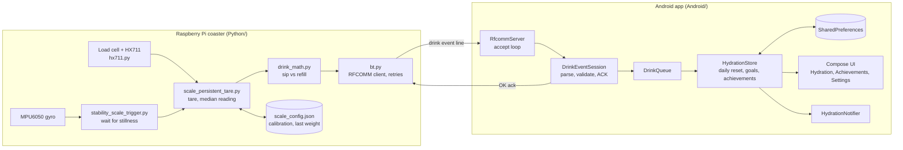

# DrinkSync

[](https://github.com/ks1686/DrinkSync/actions/workflows/ci.yml)
[](LICENSE)
[](https://ieeexplore.ieee.org/document/11449671/)

Low-cost IoT smart coaster plus a Kotlin Android app for hydration tracking. A Raspberry Pi under the coaster weighs the cup, detects each sip, and sends it to the phone over Classic Bluetooth RFCOMM. The app stores intake locally in SharedPreferences and turns daily goals into progress, streaks, and achievements.

Rutgers Spring 2025 capstone. The project is described in a co-authored IEEE publication: [IEEE Xplore document 11449671](https://ieeexplore.ieee.org/document/11449671/).

This repository implements Classic Bluetooth RFCOMM (SPP) and SharedPreferences. It does not use BLE or Room.

## What it does

- Detects sips from a load-cell coaster (HX711) and waits for the cup to be still (MPU6050 gyro) before reading
- Sends one event per sip to the phone over Classic Bluetooth RFCOMM
- Tracks daily intake, a daily goal, streaks, and achievements on the phone
- Posts notifications at 25%, 50%, and 100% of the daily goal
- Works offline after pairing; no cloud account

## Architecture



## Layout

```text
DrinkSync/
  Android/                 Kotlin app (Jetpack Compose)
    app/src/main/java/com/example/drinksync/
      MainActivity.kt      lifecycle, permissions, wiring
      bluetooth/           RFCOMM server, per-client session, permissions
      notifications/       goal milestone notifications
      ui/                  Compose screens
      data/                SharedPreferences adapter
      HydrationStore.kt    intake, goals, streaks, achievements
      DrinkEvent.kt        wire-format parsing and unit conversion
  Python/                  Raspberry Pi service (HX711, MPU6050, RFCOMM client)
```

## Android app

Requires JDK 21 and the Android SDK (Android Studio provides both).

```bash
cd Android
./gradlew :app:testDebugUnitTest :app:assembleDebug :app:lintDebug
```

Open `Android/` in Android Studio to install on a device. On Android 12 and later the app asks for the Nearby devices (`BLUETOOTH_CONNECT`) permission, then listens as an RFCOMM service named `DrinkSyncApp`. If Bluetooth is off or the permission is granted later from Settings, the server starts the next time the app comes to the foreground. On Android 13 and later it also asks for notification permission.

Daily totals reset on the first interaction on a new calendar day. Sips under 1 oz are kept as leftover grams and added once they round to a full ounce.

## Raspberry Pi service

Install the Pi dependencies (`RPi.GPIO`, `PyBluez`, `mpu6050-raspberrypi`):

```bash
cd Python
pip install -r requirements.txt
export DRINKSYNC_BT_MAC=AA:BB:CC:DD:EE:FF   # your phone's Bluetooth address
python3 stability_scale_trigger.py
```

`DRINKSYNC_BT_MAC` is required; there is no built-in default address. On first run with no `scale_config.json`, the service tares the empty scale and saves the calibration. The file is written atomically and also stores the last weight, so a restart does not invent a drink.

Each stable reading sends only the drop since the previous reading. Two sips from a full cup log two sips, not a running total. A refill (weight goes up) resets the baseline and sends nothing. If a send fails after 3 attempts, the baseline is kept so the drop is sent with the next reading.

| File | Purpose |
| --- | --- |
| `stability_scale_trigger.py` | Entry point: waits for the gyro to report stillness, then takes a reading |
| `scale_persistent_tare.py` | HX711 setup, persistent tare, reading and sending drink events |
| `drink_math.py` | Pure sip / refill / noise decision |
| `protocol.py` | Wire format v1 encode and parse |
| `bt.py` | RFCOMM client with retries |
| `scale_config.py` | Calibration file load and atomic save |
| `hx711.py` | Vendored HX711 driver |
| `gyroscope.py` | Standalone MPU6050 debug printer |

Tests and lint run without Pi hardware:

```bash
cd Python
python3 -m unittest discover -v
ruff check . && ruff format --check .
```

## Wire format (v1)

Transport: Classic Bluetooth RFCOMM/SPP. The phone is the server, the Pi is the client.

- Service name: `DrinkSyncApp`
- UUID: `c7506ec6-09d3-4979-9db3-3b85acad20fd`

One UTF-8 line per event, newline-terminated:

```text
Weight difference: 12.50 grams
```

`<grams>` is the liquid removed since the previous stable reading. The phone converts grams to fluid ounces (`grams / 29.5735`, rounded half up), keeps leftover grams that do not yet make an ounce, and adds whole ounces to today's intake.

The phone rejects lines longer than 256 characters and amounts that are not finite, not positive, or above 10,000 g. For older senders it also accepts `Average weight: <grams> grams` and the typo `Weight Differnce: <grams> grams`; new code should not send those.

After a valid event the phone replies `OK` plus a newline. Invalid lines get no reply. The Pi waits about 2 s for the ACK and counts a completed send as success even if the ACK never arrives.

## CI

GitHub Actions runs on every push and pull request to `main`:

- Python: `ruff check`, `ruff format --check`, `python -m unittest discover`
- Android: `./gradlew :app:testDebugUnitTest :app:assembleDebug :app:lintDebug`, with the debug APK and lint report uploaded as artifacts

## Stack

Kotlin, Jetpack Compose, SharedPreferences, Classic Bluetooth RFCOMM, Python 3, Raspberry Pi, HX711, MPU6050

## License

MIT. See [LICENSE](LICENSE).
